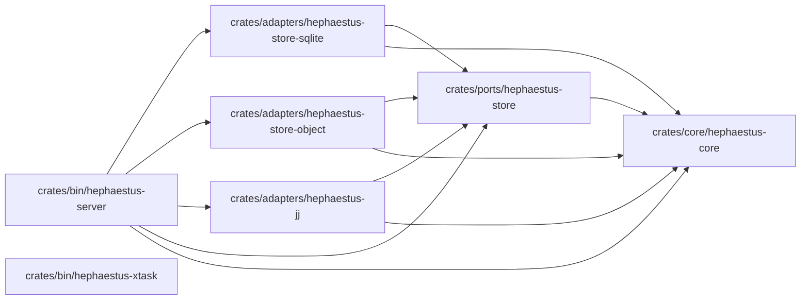

# ADR 0000: Foundations, Hexagonal Layout, and Pinned Toolchain

- **Status:** Accepted
- **Date:** 2026-11-21

## Context

Hephaestus provides an authoritative Jujutsu (`jj`) storage and replication backend designed for multi-agent and human workflows. It must guarantee:

1. Deterministic, allocation-bounded packing and cryptographic verification of content-addressed objects (`GRNB0002`), quota control, OAuth PKCE state transitions, Decision Logs, and Observation Logs.
2. Pluggable object storage across zero-cloud local filesystems, S3/R2/GCS (`object_store`), and 20 TB native-IPv6 Google Drive (`drive.file`).
3. Crash-safe idempotency and Zstd LTX snapshots in SQLite WAL.
4. Enforced architectural boundaries so transport, SQLite, or cloud HTTP dependencies never leak into domain logic.

## Decision

### 1. Hexagonal Crate Topology

### 2. Dependency Rules

1. `crates/core/hephaestus-core` is `#![no_std]` (with `alloc`), forbids `unsafe`, denies panic-inducing clippy lints, and depends on no workspace crates and no I/O, clock, network, or randomness crates.
2. `crates/ports/hephaestus-store` depends only on `hephaestus-core` among workspace crates.
3. `crates/adapters/*` depend only on `hephaestus-core` and `hephaestus-store` among workspace crates; adapters never depend on each other.
4. `crates/bin/*` are the composition roots and development tooling; no crate may depend on a `crates/bin/*` crate.
5. `cargo xtask check-layers` and `cargo xtask check-core-purity` enforce these invariants mechanically over `cargo metadata`.

### 3. Pinned Toolchain and Single-Branch `main`

- `rust-toolchain.toml` pins `1.100.0` with `rustfmt` and `clippy`.
- Workspace manifests enforce `edition = "2024"`, `resolver = "3"`, `rust-version = "1.100.0"`, `unsafe_code = "forbid"`, and `missing_docs = "warn"`.
- Development uses single-branch `main` protected by `.github/CODEOWNERS` (`* @kmosoti`) and stacked `jj` bookmarks (`stack/<topic>/01-...`).
- Third-party GitHub Actions are pinned to full 40-character commit SHAs and verified via `cargo xtask check-workflow-pins`.
