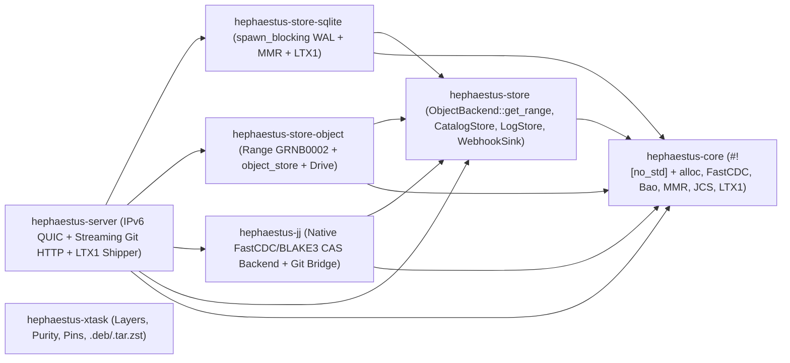

# Hephaestus Architecture

Hephaestus is an authoritative Jujutsu (`jj-lib 0.47`) storage backend, content-addressed `GRNB0002` bundle packer, FastCDC + Bao + MMR cryptographic storage core, Decision Log and Orthogonal Observation Log engine, and pure-IPv6 Ed25519 mTLS SPKI-pinned QUIC replication daemon.

## 1. Hexagonal Workspace & Purity Gates

The workspace enforces strict inward dependency flow checked by `cargo xtask check-layers` and `cargo xtask check-core-purity`:

### Hard Invariants
- **`hephaestus-core`** (`#![no_std]` + `alloc`, `#![forbid(unsafe_code)]`, denies `unwrap_used`, `expect_used`, `panic`, `todo`, `unimplemented`): zero network, filesystem, randomness, or wall-clock dependencies. All time is injected as deterministic `MonoTime`.
- **`hephaestus-store`**: async driven port traits (`ObjectBackend` including `get_range`, `CatalogStore`, `LogStore`, `WebhookSink`) using object-safe `BoxFuture`.
- **Adapters never depend on each other**: `hephaestus-store-sqlite`, `hephaestus-store-object`, and `hephaestus-jj` depend solely on `hephaestus-core` and `hephaestus-store`.
- **Workspace crates forbid `unsafe`**: enforced via `[workspace.lints.rust] unsafe_code = "forbid"` and `missing_docs = "warn"`.

## 2. Core `#![no_std]` Algorithms & Data Formats

### FastCDC, Bao Verified Streaming, & Framed `GRNB0002` Range Bundler
- **FastCDC (`cdc.rs`)**: 256-entry compile-time `u64` Gearhash table with normalized chunking masks (`min = 8 KiB`, `avg = 32 KiB`, `max = 128 KiB`) providing shift-resilient content-defined deduplication.
- **Bao (`bao.rs`)**: BLAKE3 binary Merkle tree with 1 KiB leaf chunks supporting outboard/inboard encoding and compact byte-range slice proof verification against a 32-byte root hash without downloading full blobs.
- **Two-Tier CAS & `GRNB0002` Range Reads (`bundler.rs`, `cas_engine.rs`)**: Blobs `<= 8 KiB` stay inline in SQLite WAL; larger blobs stage in an `O(log N)` `BTreeSet`-indexed `BundleAccumulator` and seal into `GRNB0002` archives (`256 KiB` independent Zstd frames via `#![no_std]` `ruzstd`). `PackedCasEngine::get_blob` fetches ONLY the frame directory prefix + target Zstd frame via `ObjectBackend::get_range` (`parse_frame_directory_header` + `unpack_blob_from_frame`), falling back to full reads only for legacy `GRNB0001`.

### BLAKE3 MMR, JCS Canonicalization, & Hash-Chained Logs
- **Merkle Mountain Range (`mmr.rs`)**: Pure `#![no_std]` BLAKE3 MMR providing `append`, `root`, `peaks`, and `O(log N)` inclusion proof verification (`verify_inclusion_proof`).
- **Decision Log & Orthogonal Observation Logs (`decision_log.rs`, `observation_log.rs`, `jcs.rs`)**: Append-only per-repository chains keyed by Jujutsu `(ChangeId, CommitId, OpId)`. Each record commits both its `prev_hash` chain link and its cumulative `mmr_root`, while `ObservationRecord::metadata_json` is canonicalized per RFC 8785 (JCS) before hashing so key ordering is deterministic.

### Litestream `"LTX1"` Format & Hardened Google Drive Adapter
- **`LTX1` (`ltx_format.rs`, `ltx.rs`)**: Real 100-byte big-endian `"LTX1"` header, strictly ascending 1-based page frames (`4B pgno + page_bytes`), 4-byte zero terminator, and 16-byte trailer (`post_apply_checksum` + CRC-64/ISO file checksum), Zstd-compressed and tracked in `ltx_snapshots` with atomic `fsync` restore.
- **Google Drive (`drive_http.rs`, `drive_client.rs`)**: Shared `Arc<RwLock<DriveOAuthFsm>>` automatic token refresh, 8 MiB (256 KiB-aligned) chunked `Content-Range` resumable uploads recovering from `308 Resume Incomplete` via `Range:`, HTTP `Range:` reads, `Retry-After` parsing on `429`/`503`, `403` rate-limit vs permission classification, and paginated `list_bundles` for DR recovery.

## 3. SQLite WAL, Native `HephaestusBackend`, & IPv6 Transport

- **Non-blocking SQLite (`hephaestus-store-sqlite`)**: `PRAGMA page_size = 16384`, `WAL` mode, all operations dispatched via `tokio::task::spawn_blocking`. Atomic `BEGIN IMMEDIATE` transactions eliminate check-then-act races on `upsert_ref_idempotent`, `append_decision_idempotent`, and `append_observation_idempotent`. `ObservationFilter` predicates (`change_id`, `commit_id`, `op_id`, `kind`, `passed`, `since_seq`, `limit`) execute in parameterized SQL using `idx_observations_*`, and `mmr_nodes` supports `O(log N)` proof lookups.
- **Native `HephaestusBackend` (`hephaestus-jj`)**: Directly stores Jujutsu files (FastCDC-chunked + BLAKE3 manifests), trees, commits, and symlinks in BLAKE3 CAS (`store_path/cas/` or live `CatalogStore` + `ObjectBackend` ports) without delegating to `SimpleBackend`.
- **IPv6 QUIC & Streaming Git Smart-HTTP (`hephaestus-server`)**: Chunked QUIC streams up to 64 MiB (`64 KiB` chunks), tuned `quinn::TransportConfig` windows, bounded `Semaphore` concurrency, per-stream read timeouts, persisted Ed25519 TLS identity (`--tls-key-path` / `CREDENTIALS_DIRECTORY/tls-ed25519.pem`), and constant-time SPKI SHA-256 mTLS pin verification (empty allowlists rejected unless `--dev-ephemeral`). Git smart-HTTP validates `{repo}` (`^[a-zA-Z0-9._-]+$`), streams packfiles through async child pipes without buffering in RAM, imports refs into `jj`, syncs to CAS, fires `WebhookSink`, and runs a background `"LTX1"` snapshot shipper.
